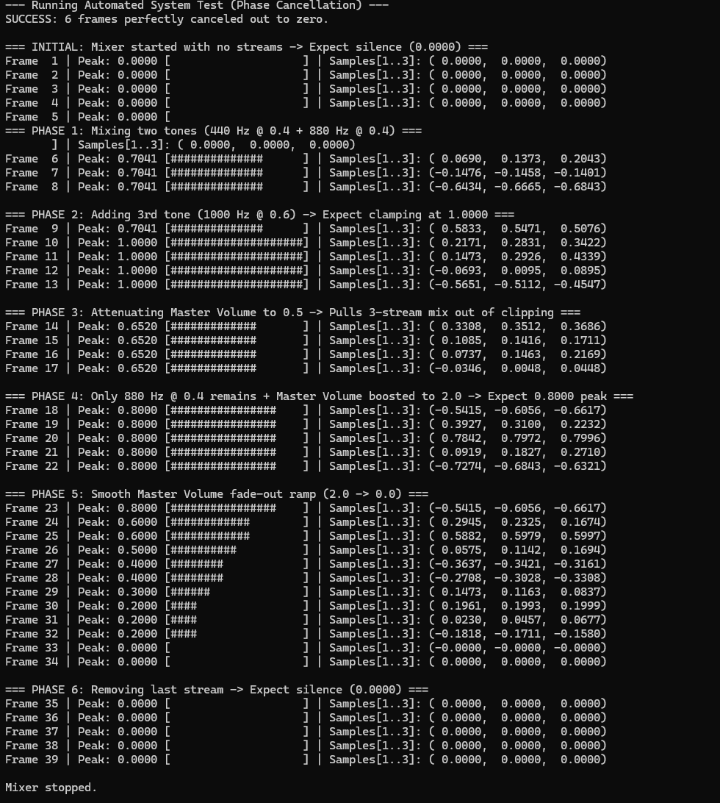

# Real-Time Audio Mixer Sample

This repository contains a simple C++ sample implementation of a real-time audio mixer. The project demonstrates core systems programming concepts—such as multi-threading, synchronization, and basic audio processing—by mixing multiple sinusoidal tone streams into a single output stream.

## Key Features

* **Thread-Safe Mixing:** Uses standard library concurrency tools (`std::thread`, `std::mutex`, `std::atomic`) to run a background mixing loop.
* **Dynamic Streams:** Supports adding and removing input streams at runtime.
* **Buffer Processing:** Sums incoming audio samples frame-by-frame and applies basic amplitude clamping.
* **Console Demo:** Includes a simple console output stream to display real-time volume meters and sample values for verification.

## Example Output

